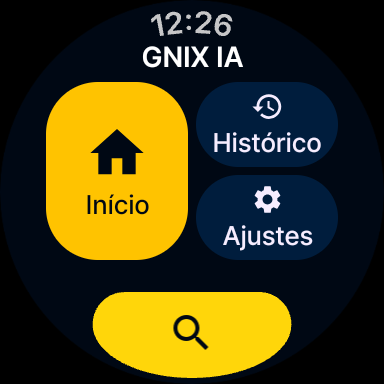
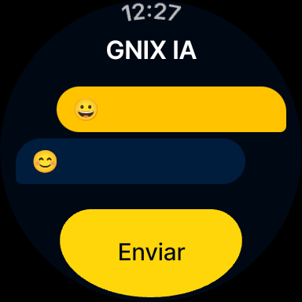

# GNIX IA


Assistente de IA para **Wear OS** que roda um modelo **Gemma** direto no relógio, sem internet. Você pergunta por voz ou teclado, recebe a resposta em português do Brasil, e as conversas ficam salvas no histórico.

<p align="center">
  
  &nbsp;&nbsp;
  
</p>

## Funcionalidades

- **Chat com IA no relógio**: o modelo Gemma 3 270M (GGUF) roda localmente com [llama.cpp](https://github.com/ggml-org/llama.cpp); a resposta aparece enquanto é gerada.
- **Roda em relógios 32 e 64 bits**, incluindo o Galaxy Watch 7 (`armeabi-v7a`).
- **Funciona offline**: nenhuma pergunta sai do relógio.
- **Respostas em português do Brasil**, curtas, pensadas para tela pequena.
- **Entrada por voz, teclado ou emoji** pelo teclado do sistema do Wear OS.
- **Histórico** de perguntas e respostas salvo localmente (Room), com tela de detalhe e opção de apagar tudo.
- **Home** com atalhos para Apresentação, Histórico e Configurações, e botão de pesquisa que leva a pergunta direto ao chat.
- **Splash screen** e tema próprio (azul-marinho e amarelo).

## Requisitos

| Item | Versão |
|---|---|
| Android Studio | com suporte a AGP 9.5 (alpha) |
| Android NDK | 28.2.13676358 |
| CMake | 3.31.6 |
| Wear OS | API 33+ (`minSdk 33`) |
| Arquitetura | `armeabi-v7a`, `arm64-v8a` ou emulador `x86_64` |

## Como rodar

1. Clone com o submódulo do llama.cpp:

   ```bash
   git clone --recurse-submodules --shallow-submodules https://github.com/davigomesflorencio/wear_gnix_ia_gemma.git
   # ou, num clone que já existe:
   git submodule update --init --depth 1
   ```

   No Windows, se o checkout do submódulo ficar incompleto, ative caminhos longos com `git -C app/src/main/cpp/llama.cpp config core.longpaths true` e rode `git -C app/src/main/cpp/llama.cpp restore --source=HEAD :/`.
2. Baixe o modelo `gemma-3-270m-it-Q4_0.gguf` (por exemplo, de [ggml-org/gemma-3-270m-it-GGUF](https://huggingface.co/ggml-org/gemma-3-270m-it-GGUF)) e coloque em `app/src/main/assets/`.
3. Abra o projeto no Android Studio.
4. Rode no relógio ou no emulador Wear OS:

   ```bash
   ./gradlew installDebug
   ```

A primeira compilação demora alguns minutos, porque o llama.cpp é compilado para as três arquiteturas. Ele é sempre compilado otimizado (`-DCMAKE_BUILD_TYPE=Release`), mesmo no build de debug do app, porque sem otimização fica dezenas de vezes mais lento.

Na primeira abertura, o app copia o modelo dos assets para o armazenamento interno e o carrega. Isso pode levar alguns segundos, e o chat mostra o progresso.

> O modelo tem centenas de MB e passa do limite de 100 MB por arquivo do GitHub, por isso os arquivos `.gguf` estão no `.gitignore`. Depois de clonar o projeto, baixe o modelo e coloque-o na pasta `assets`.

## Arquitetura

O app segue **Clean Architecture** em um único módulo, com injeção de dependência manual (`AppContainer`):

```
com.davi.dev.gnixia
├── GnixiaApplication.kt        cria o AppContainer
├── di/                         AppContainer (injeção manual)
├── domain/                     regras do app, sem Android
│   ├── model/                  HistoryEntry, ModelStatus
│   ├── repository/             ChatRepository, HistoryRepository (interfaces)
│   └── usecase/                InitializeModel, SendMessage, ObserveHistory,
│                               ObserveHistoryEntry, ClearHistory
├── data/                       implementações
│   ├── llm/                    LlmEngine, GemmaLlamaCppEngine, LlamaBridge (JNI),
│   │                           ModelDownloader
│   ├── local/                  Room: AppDatabase, ChatHistoryDao, ChatHistoryEntity
│   └── repository/             ChatRepositoryImpl, HistoryRepositoryImpl
└── presentation/               UI em Jetpack Compose para Wear OS
    ├── MainActivity.kt
    ├── navigation/             Routes, AppNavigation (Navigation 3)
    ├── home/                   HomeScreen
    ├── chat/                   ChatScreen, ChatViewModel
    ├── history/                HistoryScreen, HistoryDetailScreen, HistoryViewModel
    ├── about/                  AboutScreen
    ├── settings/               SettingsScreen
    ├── common/                 rememberTextInputLauncher
    └── theme/                  GnixiaTheme, GnixiaStyles (Styles API)

app/src/main/cpp/
├── CMakeLists.txt              compila o llama.cpp e a libgnixia-llm.so
├── gnixia_llm.cpp              ponte JNI: carregar, gerar token a token, reset, liberar
└── llama.cpp/                  submódulo (tag v0.7.0)
```

- O `SendMessageUseCase` envia a resposta do modelo em partes para a tela e salva a pergunta e a resposta no histórico quando a geração termina.
- O modelo fica no `ChatRepositoryImpl`, que dura enquanto o app estiver aberto, e é carregado uma única vez.
- O comportamento do modelo (responder sempre em pt-BR e de forma breve) é definido em `GemmaLlamaCppEngine.SYSTEM_INSTRUCTION`. O Gemma não tem papel de sistema, então a instrução vai no primeiro turno do usuário.
- A conversa fica no contexto do modelo (2048 tokens). Quando ele enche, o histórico do contexto é descartado e a conversa recomeça.

## Navegação

| Rota | Tela |
|---|---|
| `HomeRoute` | Home (tela inicial) |
| `ChatRoute` | Chat |
| `HistoryRoute` | Lista do histórico |
| `HistoryDetailRoute(id)` | Pergunta e resposta completas |
| `AboutRoute` | Apresentação do app |
| `SettingsRoute` | Configurações |

A navegação usa **Navigation 3** com `rememberSwipeDismissableSceneStrategy()`: deslize para a direita para voltar.

## Tecnologias

- Kotlin 2.4 · Jetpack Compose (BOM 2026.09.00)
- Wear Compose Material 3 1.7 · Wear Compose Navigation 3
- llama.cpp v0.7.0 via JNI (C++ 17, NDK, CMake) com Gemma 3 270M em GGUF Q4_0
- Room 2.8 + KSP
- Lifecycle ViewModel · Kotlin Coroutines/Flow
- Core SplashScreen · Wear Input (RemoteInput)
- Compose Styles API (experimental) nos balões do chat

## Textos e tradução

Todos os textos da interface ficam em `app/src/main/res/values/strings.xml`. Para traduzir, crie `values-<idioma>/strings.xml` com as mesmas chaves.

## Changelog

Veja o [CHANGELOG.md](CHANGELOG.md).
